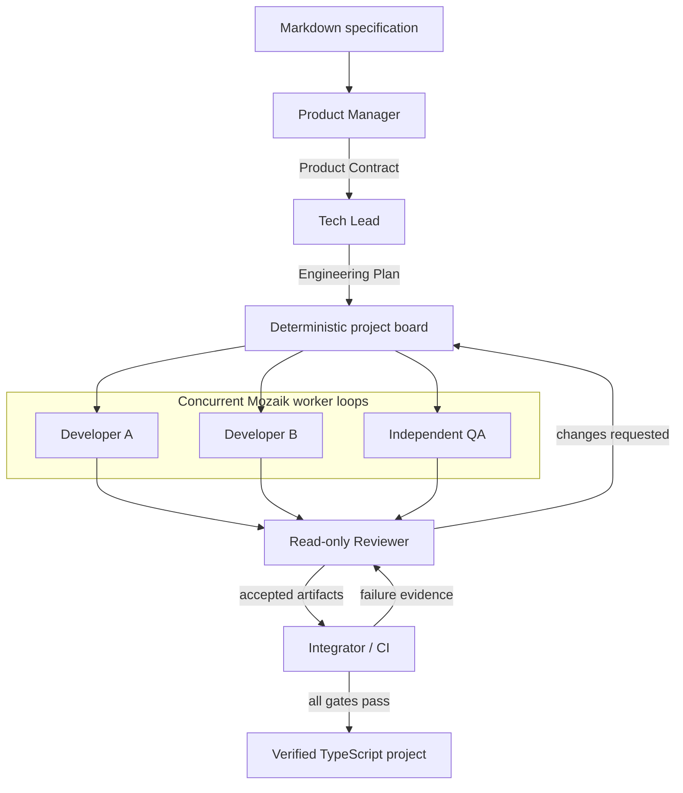

# Mozaik Software Factory

[](https://github.com/AllForJoon/NTP_Novi_Sad_Hackathon_Software_Factory/actions/workflows/ci.yml)

**A Markdown specification becomes a verified TypeScript project through a concurrent AI engineering team.**

JigJoy NTP Novi Sad Hackathon 2026 · Track 01: Software Factory · Built on **Mozaik v4.2.0**.

Product Manager, Tech Lead, two developers, independent QA and a read-only Reviewer work through Mozaik events and tool loops. A deterministic Integrator owns the final compiler, test and HTTP-startup gates. A model saying "done" cannot complete a project.

**Start here:** [Submission guide](docs/SUBMISSION.md) · [Live evidence and generated projects](docs/evidence/jigjoy-2026-10-31/README.md) · [Architecture](docs/ARCHITECTURE.md) · [Hosted inference investigation](docs/JIGJOY_HOSTED.md)

## Verified live results

These are actual JigJoy-hosted runs, **without demo flags**, recorded on 2026-10-31 KST. Generated QA and a separate acceptance checker both exercised the built projects.

| Specification | Factory result | Generated QA tests | Independent checks |
| --- | --- | ---: | ---: |
| [Sum CLI](specs/examples/sum-cli.md) | COMPLETED | 25 | 15 |
| [Notes HTTP API](specs/examples/notes-api.md) | COMPLETED | 10 | 16 |
| [UTF-8 file statistics CLI](specs/validation/file-counts.md) | COMPLETED | 16 | 15 |
| [Task HTTP API](specs/validation/tasks-api.md) | COMPLETED | 21 | 22 |

The last two specifications were unseen when first executed; their exact inputs are now committed for reproduction. [Recorded timestamps](docs/evidence/jigjoy-2026-10-31/manifest.json) establish real overlap among Developer A, Developer B and QA in all four runs. The file-statistics run also completed an automatic Reviewer → QA revision → recheck cycle.

## Run a real Factory

Requires **Node.js 22+**, npm, and a JigJoy account with hosted inference access. From the repository root:

```sh
npm ci
cp .env.example .env
npm install -g baro-ai@0.121.0
baro login
npm run factory -- ./specs/examples/sum-cli.md
```

`cp` also works as the PowerShell `Copy-Item` alias. Keep an existing private `.env` instead of overwriting it. Normal `npm ci` applies the checked-in Mozaik compatibility patch automatically.

The supplied configuration selects:

```dotenv
FACTORY_PROVIDER=jigjoy
FACTORY_MODEL=deepseek-flash
FACTORY_REASONING_EFFORT=low
```

**JigJoy mode requires no OpenAI, Anthropic or Gemini API key.** The official Baro helper exchanges the local login session for a short-lived gateway credential; the runner keeps it in memory. Mozaik Cloud pairing is separate and continues exporting redacted telemetry if already paired. Account credits and service limits still apply; Pro membership alone is not a promise of unlimited inference.

For the HTTP example:

```sh
npm run factory -- ./specs/examples/notes-api.md
```

Success ends with `COMPLETED` and exit code 0. Inspect `output/<run-id>/` for the project and verification record, and `traces/<run-id>/` for timestamped events and state. CLI projects must pass typecheck, build and QA tests; HTTP projects must additionally start a real server and answer an HTTP request. Generated projects use Node built-ins only.

## Review without an inference account

```sh
npm ci
npm run typecheck
npm run build
npm test
npm run verify:evidence
```

- `npm test`: **73 deterministic runtime regression tests**, including a three-worker concurrency barrier, strict schemas, planning repair, CI/BUG recovery, tool isolation, credential redaction and repeated hosted-adapter tool calls.
- `npm run verify:evidence`: checks archived artifact hashes and concurrency evidence, recompiles all four unchanged live-generated deliveries, reruns **72 generated QA tests** and **68 independent acceptance checks**, including both HTTP startup gates. This is an **offline replay of real outputs**, not a new inference run. Scratch projects remain in ignored `.work/` for inspection.

To independently check a new built delivery:

```sh
npm run verify:output -- sum-cli output/<run-id>
```

Supported checkers are `sum-cli`, `notes-api`, `file-counts` and `tasks-api`. This task-specific oracle is outside the Factory and never supplies implementation code to its agents.

Optional recovery demonstration:

```sh
npm run smoke:recovery
```

The smoke commands use explicitly scripted offline inference. The recovery fixture inserts a real defect, observes a failing Node assertion, creates a BUG ticket and verifies the generated repair. They are separate from the hosted results above. [GitHub Actions](https://github.com/AllForJoon/NTP_Novi_Sad_Hackathon_Software_Factory/actions/workflows/ci.yml) runs the regression suite, archived-output replay and both smoke checks on Ubuntu and Windows without provider secrets.

## How it works



- **Differentiated authority:** PM and Tech Lead plan; developers own disjoint source files; QA owns tests; Reviewer cannot edit or run tools; CI controls scaffold and completion.
- **Genuine concurrency:** initially independent developer tickets and QA are dispatched without awaiting one another. Isolated workspaces and hashed artifacts prevent shared-file overwrites.
- **Bounded autonomous repair:** invalid semantic plans return to Tech Lead; rejected artifacts return to their owner; failed CI produces Reviewer-classified BUG tickets and fresh verification. Provider/auth/quota failures remain separate from product defects.
- **Strict local validation:** original Zod contracts and ownership/DAG rules remain authoritative. Hosted JSON-format fallback changes generation guidance, not acceptance rules.
- **Mozaik remains the runtime:** `defineRuntime`, participants, events and `runLoop` orchestrate every role. The custom JigJoy runner only translates inference; Baro supplies authentication, not orchestration.

## Repository map

| Path | Purpose |
| --- | --- |
| `src/factory/`, `src/state.ts` | Mozaik event handlers, board, review and integration |
| `src/participants/`, `src/schemas.ts` | Role policies and strict contracts |
| `src/runtime/` | Hosted runner, provider retries, schemas and situations |
| `src/tools/`, `src/tracing/` | Owned-file tools, fixed checks and redacted evidence |
| `tests/` | Runtime and adapter regression tests |
| `specs/examples/`, `specs/validation/` | Bundled and originally unseen specifications |
| `scripts/` | Independent output verification and archived-delivery replay |
| `docs/evidence/` | Curated live traces, hashed generated sources and verification |
| `patches/` | Version-pinned Gemini tool-signature compatibility patch |

## Configuration and limits

See [.env.example](.env.example) and the [configuration reference](docs/ARCHITECTURE.md#configuration). External `openai`, `anthropic`, `gemini`, and legacy `auto` modes remain available with matching models/keys. JigJoy aliases are checked by the hosted gateway rather than Mozaik's upstream registry.

Scope is small TypeScript CLIs and in-memory HTTP APIs, with no runtime dependencies, database, frontend or deployment. Generated code executes with the invoking user's privileges; this is not an OS sandbox. Runs, retries and tool calls are bounded; there is no crash resume. Hosted verification covers one Chat Completions model, not every account/model entitlement. SDK-provider cancellation can finish later than its outer deadline; the JigJoy fetch runner also aborts its own requests. Passing finite tests does not prove arbitrary-spec correctness.

[Documentation index](docs/README.md) · [MIT license](LICENSE)
