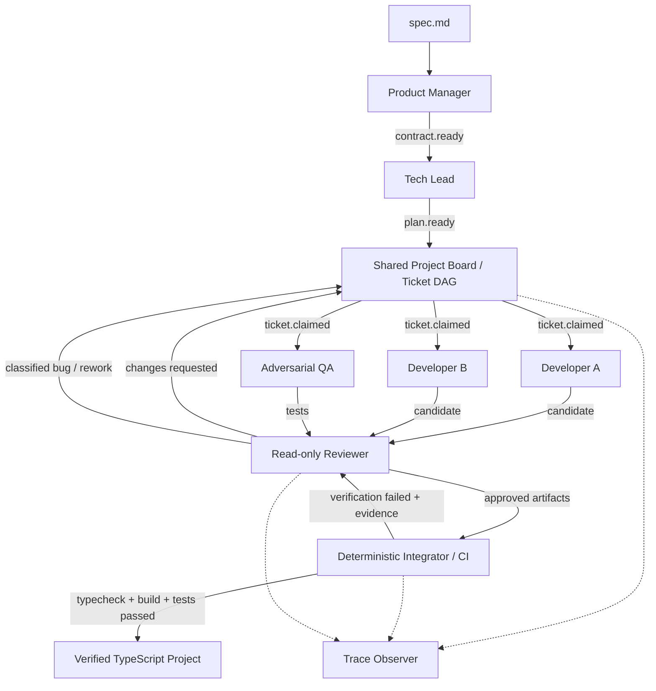

# AI Software Company

A Markdown specification goes in. A small TypeScript CLI or HTTP API, with actual build and test evidence, comes out.

**Do not ask one AI to write software. Run an AI development organization.**

Built for JigJoy NTP Novi Sad Hackathon 2026, Track 01: Software Factory. This repository started empty; this is its first working implementation.

## Run it

Requires **Node.js 22+** and npm. Run commands from the repository root.

```sh
npm ci
```

Copy `.env.example` to `.env` and set the provider key for the models you use. One provider/key and a shared model are enough. The default is `gpt-5.4-mini` from the pinned Mozaik registry.

```sh
npm run factory -- ./specs/examples/sum-cli.md
```

For an HTTP API example:

```sh
npm run factory -- ./specs/examples/notes-api.md
```

The command exits with code 0 **only** after reviewer acceptance and deterministic typecheck, build and tests succeed. An invalid spec, exhausted repair budget, provider outage or infrastructure failure exits nonzero. Do not edit generated projects during a run.

No API key? Reproduce the full local runtime with the bundled fixture:

```sh
npm run smoke
npm run smoke:recovery
```

These two commands use **scripted responses, not an LLM**. They exercise the same Mozaik runtime, actual tool calls, three concurrent worker loops, filesystem isolation, reviewers, compiler and Node test processes. The recovery fixture deliberately omits empty-string validation in its first candidate. QA's real tests fail, a real bug ticket wakes Developer B, and CI runs again. Offline CLI mode only accepts the exact bundled Sum CLI spec; it does not pretend to generate arbitrary software without a model.

## The organization

| Participant | Objective and context | Tools and authority | Trigger / output |
| --- | --- | --- | --- |
| Product Manager | Extract observable requirements from the original spec | No coding, filesystem or shell tools | `spec.received` → strict Product Contract |
| Tech Lead | Choose minimal architecture, exact interfaces, file ownership and ticket DAG | No coding or execution tools | `contract.ready` → strict Engineering Plan |
| Developer A | Functional behavior, simple implementation, fast delivery; contract + assigned ticket + interfaces | Read/list/search candidate; write assigned production files; bounded checks | Own `ticket.claimed` → isolated source artifacts |
| Developer B | Validation, boundary cases, error handling and maintainability; reliability ticket and failure evidence | Same bounded tool vocabulary, different owned files and priorities | Own `ticket.claimed` → isolated reliability artifacts |
| QA | Try to break the contract; initially contract + published interfaces, without implementation assumptions | Write only `tests/contract.test.mjs`; cannot edit production | Own `ticket.claimed` → adversarial Node tests |
| Reviewer | Critique artifacts and evidence; classify CI failures and route fixes | Read-only structured inputs, no editing or execution tools | `review.requested` → strict verdict / blocking issues |
| Project Board | Track dependencies, ownership and availability | Deterministic state transitions and scheduling | Plan/rework events → claims for READY work |
| Integrator / CI | Assemble accepted artifacts and determine actual success | Fixed Node/compiler commands, real exit codes | `integration.requested` → verification evidence |
| Trace Observer | Record actual activity and metrics | Deterministic JSONL/log/state writer | Runtime and company events → local trace |

The six AI roles differ in instructions, context, triggers, schemas, evaluation criteria and write authority. All can share a model; role-specific model overrides are optional. PM never receives source tools; QA cannot fix production; the Reviewer cannot fix anything. Coding tools are scoped to the current ticket at turn creation. Each turn uses a fresh `ModelContext` with explicit relevant inputs rather than inheriting every other participant's conversation.

## Mozaik v4 architecture

The pinned dependency is **`@mozaik-ai/core@4.2.0`**. The implementation uses current public `defineRuntime`, `RuntimeState`, `createAgent`, `createHuman`, `SemanticEvent`, `SituationSpecification`, situation processors, and `runLoop` APIs. There is no legacy Baro wiring or alternative event bus. See the official [runtime documentation](https://docs.jigjoy.ai/docs/runtime) and [agent loop](https://docs.jigjoy.ai/docs/agent-loop).



`EngineeringState extends RuntimeState` is the project board: original spec, Product Contract, plan, ticket statuses and retry counts, artifact hashes, review verdicts, command/test results, categorized failures, metrics and explicit human interventions. A snapshot is persisted at milestones and on termination.

The board reacts to events rather than awaiting a fixed sequence of developers. It starts one READY ticket per available owner. Approved dependency artifacts unlock dependent tickets. Development tickets move through `BACKLOG → READY → IN_PROGRESS → IN_REVIEW → TESTING → DONE`, with bounded `FAILED → READY` review repair. `TESTING` means reviewer accepted, waiting for the final global gate; it does not mean tests have passed. Only CI can authorize project completion.

Events include `spec.received`, `contract.ready`, `plan.ready`, `ticket.claimed`, `ticket.completed`, `qa.started`, `qa.completed`, `review.requested`, `review.approved`, `review.changes_requested`, `integration.requested`, `integration.completed`, `verification.started`, `verification.failed`, `verification.passed`, `bug.created`, `rework.requested` and terminal project events.

### Real concurrency and isolation

The plan validator requires initially independent work for **both** developers. The board dispatches their claims and QA's claim without awaiting other turns. Mozaik's fire-and-forget `runLoop` and nonblocking situation processors allow their actual inference and tool work to overlap. There is no `await devA(); await devB()` pipeline.

The concurrency test uses a barrier: no worker can finish its initial inference until all three workers have entered it. A sequential implementation would time out. It also checks that the measured work intervals overlap.

```text
.work/<run-id>/<owner>/<ticket-id>/attempt-<retry>/
output/<run-id>/
traces/<run-id>/
  events.jsonl
  activity.log
  state.json
```

Every ticket owns explicit files; overlapping ownership, traversal, symlinks and reserved filenames are rejected. QA has a separate test artifact. Workers submit SHA-256 recorded artifacts rather than overwriting a shared checkout. The integrator combines approved artifacts in deterministic path order and checks hashes before copying and after verification. Repair work is seeded with accepted artifacts and the ticket's previous candidate.

### Deterministic gates and automatic recovery

CI owns the generated `package.json` and `tsconfig.json`; models cannot rewrite verification scripts. Projects use Node built-ins only. CI reuses the installed factory TypeScript toolchain via an ignored `node_modules` directory link, so generated dependency installation is unnecessary during a run. A copied standalone project declares its own development dependencies; run `npm install --ignore-scripts` there before using it.

CI runs, in order:

1. TypeScript typecheck (`--noEmit`).
2. TypeScript build.
3. Node's test runner against QA's `.test.mjs` artifacts.

A failed step stops that attempt. Every process records command, explicit cwd, stdout, stderr, exit code, signal, duration, timeout and spawn error. Text such as “DONE” or “tests passed” is never sufficient evidence.

On implementation/test failure the Reviewer receives the actual command output, contract, ownership and candidate artifacts. It must identify blocking issues and existing owned files. The board creates `BUG-*` tickets, assigns the relevant original owner, wakes that worker, requests another review, integrates the repair and reruns CI. A source ticket's CI repair budget defaults to **2**; review rejection retries are also bounded. Unfixable candidates terminate as `FAILED`.

Provider failures have a separate small retry budget and never create semantic bug tickets. Timeouts, spawn errors and signals are infrastructure failures and terminate with their evidence. Invalid structured output/unauthorized tools are protocol failures. Mozaik 4.2.0's fire-and-forget loop does not expose a public rejected-promise callback, so the bounded inference adapter converts provider rejection into a typed fault answer that follows the factory's explicit failure path.

### Trace and metrics

`events.jsonl` contains real timestamps, run ID, participant ID, role, ticket ID, action, start/end/instant phase, elapsed time, retry, model, provider token usage when supplied, estimated cost when configured, and human intervention count. Commands have bounded captured output. Raw provider responses/prompts are omitted from local event logs. Environment secrets and common API-key patterns are redacted from persisted evidence. `state.json` includes contract and project state; treat specifications and source as potentially private.

Token totals and cost are `null` when unavailable or incomplete, including offline fixtures. `knownInputTokens` and `knownOutputTokens` preserve measured subsets; metered/unmetered call counters explain coverage. Optional rates are user-supplied estimates, not a pricing claim. Different model prices require choosing suitable rates or extending per-model accounting. Mozaik's optional built-in cloud integration may activate if its credentials already exist; this factory forces its payload redaction to `all`. Local traces are the authoritative evidence.

Normal invocation counts as zero human interventions. `EngineeringState.recordHumanIntervention(reason, description)` is the explicit API for a host/UI to record an actual human action. Hash mismatches fail integrity checks; they do not falsely identify an unknown actor as a human. This v1 does not infer edits made and reverted between checkpoints.

## Configuration

| Variable | Default / purpose |
| --- | --- |
| `OPENAI_API_KEY`, `ANTHROPIC_API_KEY`, `GEMINI_API_KEY` | Key for the provider(s) of your selected Mozaik models |
| `FACTORY_MODEL` | `gpt-5.4-mini`; shared fallback model |
| `PM_MODEL`, `TECH_LEAD_MODEL` | Optional PM and planning overrides |
| `IMPLEMENTATION_DEV_MODEL`, `RELIABILITY_DEV_MODEL` | Optional developer overrides |
| `QA_MODEL`, `REVIEWER_MODEL` | Optional testing and review overrides |
| `MAX_RETRIES_PER_TICKET` | `2`; bounded review/CI repairs |
| `MAX_PROVIDER_RETRIES` | `1`; additional provider attempts per turn |
| `MAX_MODEL_CALLS_PER_TURN` | `30`; bounds tool/inference loops |
| `MODEL_TIMEOUT_MS` | `120000` per inference request |
| `COMMAND_TIMEOUT_MS` | `30000` per child command |
| `RUN_TIMEOUT_MS` | `900000` per factory run |
| `INPUT_USD_PER_MILLION`, `OUTPUT_USD_PER_MILLION` | Unset; optional uniform estimated token rates |

Selected live model names must exist in the pinned Mozaik registry. Custom providers/configurations can be supplied through the `runFactory({ runner })` TypeScript API. Do not put keys in specs, source files or committed `.env` files.

## Verification and development

```sh
npm run typecheck
npm run build
npm test
npm run smoke
npm run smoke:recovery
```

Tests cover contract/reference validation, DAG and ownership checks, state transitions, repair limits, real process evidence, filesystem boundaries, artifact tampering, child environment/timeout behavior, bounded provider faults, concurrent worker barriers and end-to-end failure/recovery. GitHub Actions runs the checks and both offline smokes on Ubuntu and Windows.

Inspect a successful project's `product-contract.json`, `factory-verification.json`, `src/`, `tests/`, and its matching trace directory. For the Sum CLI delivery:

```sh
# From output/<run-id>
npm run build
npm test
node dist/index.js sum 2 3
```

Source map: `src/factory/company.ts` wires event handlers; `src/runtime/` contains situations and bounded inference; `src/participants/prompts.ts` defines role policies; `src/schemas.ts` validates contracts/plans/verdicts; `src/state.ts` holds the board; `src/tools/` enforces file and process boundaries; `src/tracing/` writes evidence; `src/testing/` contains the explicitly scripted offline fixture.

## Limits and next steps

- General CLI/HTTP generation requires real model credentials. The checked local E2E path is the offline Sum CLI fixture; it is not evidence of arbitrary-spec live model quality or of the HTTP example passing.
- Scope is small Node-only projects: no external runtime dependencies, database, authentication, frontend or deployment. Ambiguities are recorded with conservative assumptions; there is no interactive requirements negotiation.
- Tool permissions, fixed commands, clean child environments, timeouts and artifact hashes are application boundaries, **not an OS security sandbox**. Generated JS/tests execute with the invoking user's filesystem/network privileges. Provider HTTP requests are raced against a deadline; the underlying SDK request may finish later because the Mozaik inference interface exposes no abort signal.
- There is one worker per developer role and one queued Reviewer. The runtime supports independent tickets, not a distributed queue, crash resume or durable transaction processing.
- Agents are instructed to emit one tool call at a time. The adapter retains the first tool call when a provider batches calls, matching Mozaik 4.2.0's loop; it preserves reasoning context. Future versions should handle complete batches explicitly.
- Passing tests prove the supplied assertions, not exhaustive correctness. The read-only reviewer and adversarial QA reduce, but cannot eliminate, missing assertions.

Highest-priority improvements: run real provider-backed CLI and HTTP challenge specs; evaluate contract/test coverage on unseen tasks; add process/container isolation and cancellation; then durable resume and per-model cost accounting. No web UI is required for the first version.
