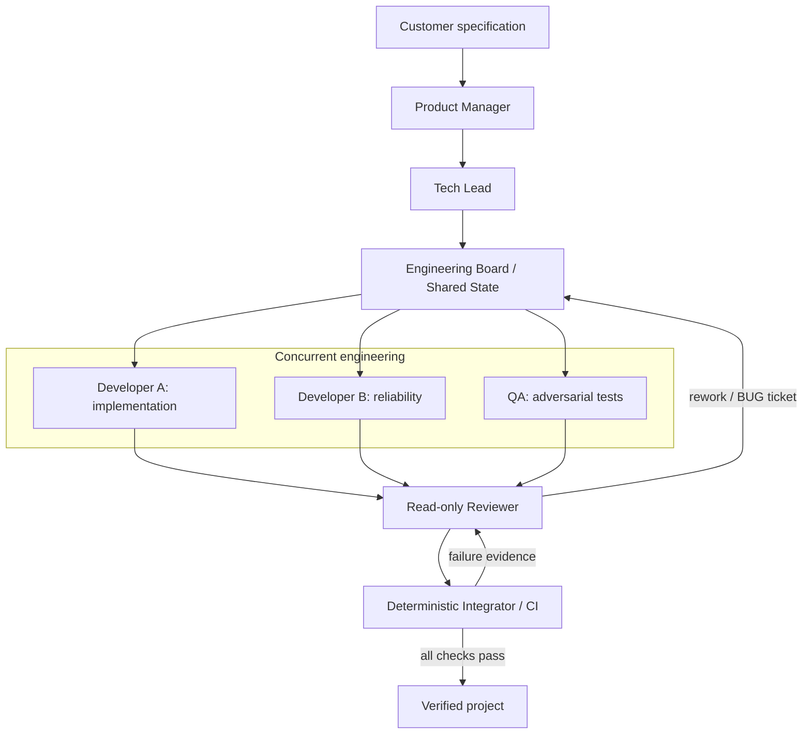

# AI Software Company

Give the factory a Markdown software specification. A team of concurrent Mozaik agents plans, implements, tests, reviews, repairs, integrates, and verifies a small TypeScript CLI or HTTP API.

## 1. What it does

```text
spec.md → Product Contract → Engineering Plan → concurrent engineering
        → review → deterministic CI → working TypeScript project
```

The same live Factory handles supported specifications without example-specific implementations. Generated projects use Node built-ins only. Completion requires real compiler/test exit codes; HTTP projects must also start a server and answer a request.

## 2. Architecture



All roles use `@mozaik-ai/core@4.2.0`: `defineRuntime`, participants, events and `runLoop`. They share typed `EngineeringState`: contract, plan, tickets, artifact hashes, reviews, verification results and metrics. Each role has different prompts, responsibilities, tools, permissions and success criteria.

**Developer A, Developer B and QA genuinely run concurrently.** The board dispatches independent tickets without awaiting other workers. Developers own disjoint source files; QA owns tests; each works in an isolated snapshot. Reviewer cannot edit or execute tools. Only Integrator / CI can complete the project.

## 3. Why it satisfies Track 01

| Criterion | Points | Implementation and evidence |
| --- | ---: | --- |
| Working generated software / hidden task | 35 | One spec command; real typecheck, build and QA tests; HTTP startup gate; CLI and API examples |
| Multi-agent architecture | 25 | Mozaik runtime, independent roles, typed shared state; three-worker barrier and overlapping live trace spans |
| Autonomy | 15 | Strict contract/plan validation, planning repair, Reviewer triage, BUG tickets, owner rework and verification rerun; bounded provider recovery |
| Transparency | 15 | Timestamped JSONL: role, ticket, duration, retries, model/provider and measured token usage; optional estimated cost; explicit human-intervention records |
| Reproducible setup | 10 | Locked install, commands below, and [Ubuntu/Windows CI](https://github.com/AllForJoon/NTP_Novi_Sad_Hackathon_Software_Factory/actions/workflows/ci.yml) |

The regression suite tests concurrency, planning recovery, CI failure → BUG → repair, filesystem isolation, artifact integrity and provider-failure separation. [One representative successful live trace excerpt](docs/example-trace.jsonl) is included; new runs generate full traces. Unavailable token/cost metrics remain `null`; costs are estimates only when rates are configured. Hosts record actual interventions through `EngineeringState.recordHumanIntervention()`; normal initialization does not count as one.

## 4. Quick Start

Requires **Node.js 22+** and npm. The supplied `.env.example` selects JigJoy hosted `deepseek-flash`; install the official Baro CLI and sign in with an account that has hosted inference access:

```sh
npm ci
cp .env.example .env
npm install -g baro-ai@0.121.0
baro login
npm run build
npm test
npm run factory -- ./specs/examples/sum-cli.md
```

PowerShell can use `Copy-Item .env.example .env`. Copy the configuration only on first setup. JigJoy mode needs no OpenAI, Anthropic or Gemini API key; it uses Baro's official credential helper. Account credit/limits apply. Existing Mozaik Cloud pairing continues exporting redacted telemetry and is separate from inference authentication. Optional external providers and execution limits are configured in [.env.example](.env.example).

`npm ci` automatically applies the required pinned compatibility [patch](patches/README.md). Generated code runs with the invoking user's privileges; use an appropriate environment for untrusted specifications.

## 5. Example and outputs

```sh
npm run factory -- ./specs/examples/sum-cli.md
# HTTP example: npm run factory -- ./specs/examples/notes-api.md
```

```text
output/<run-id>/   # src/, tests/, package.json, tsconfig.json, contract and verification
traces/<run-id>/   # events.jsonl, activity.log, state.json
```

`COMPLETED` and exit 0 require Reviewer acceptance plus passing deterministic CI, not an agent saying "done". Inspect `factory-verification.json` for command results and the matching trace for role activity and repairs. In a generated project, run `node dist/index.js sum 2 3` to print `5`.

For the official hidden task, run `npm run factory -- <provided-spec.md>`. Copy the verified project's `src/`, `tests/`, `package.json` and `tsconfig.json` to `hidden/<spec-name>/`, excluding the local `node_modules` link and `dist/`. The generated package already declares its development dependencies: `npm install --ignore-scripts`, `npm run build` and `npm test` work there without manually changing generated code. `hidden/` is not ignored; record any actual human edits explicitly.

## 6. Recovery example

```text
verification fails → Reviewer classifies failure → BUG ticket → responsible developer
                   → review → re-integration → verification
```

```sh
npm run smoke:recovery
```

This is an explicitly scripted offline fixture: it introduces a real defect, observes a failing Node test, and exercises the actual Mozaik repair/CI loop. `npm run smoke` checks the normal offline path. Both need no inference credentials. Contract/plan errors have their own repair budget; auth/quota failures receive bounded provider handling and never become product BUG tickets.

## 7. Repository structure

```text
src/              Mozaik factory, shared state, role policies, tools and tracing
tests/            Deterministic architecture, validation and recovery regressions
specs/examples/   CLI and HTTP specifications
docs/             One small, labeled live trace example
patches/          Required version-pinned runtime compatibility patch
.github/          Ubuntu and Windows verification workflow
```

Full local checks: `npm run typecheck`, `npm run build`, `npm test`, `npm run smoke`, `npm run smoke:recovery`. Runtime workspaces, generated outputs, complete traces and credentials stay untracked. [MIT license](LICENSE).
