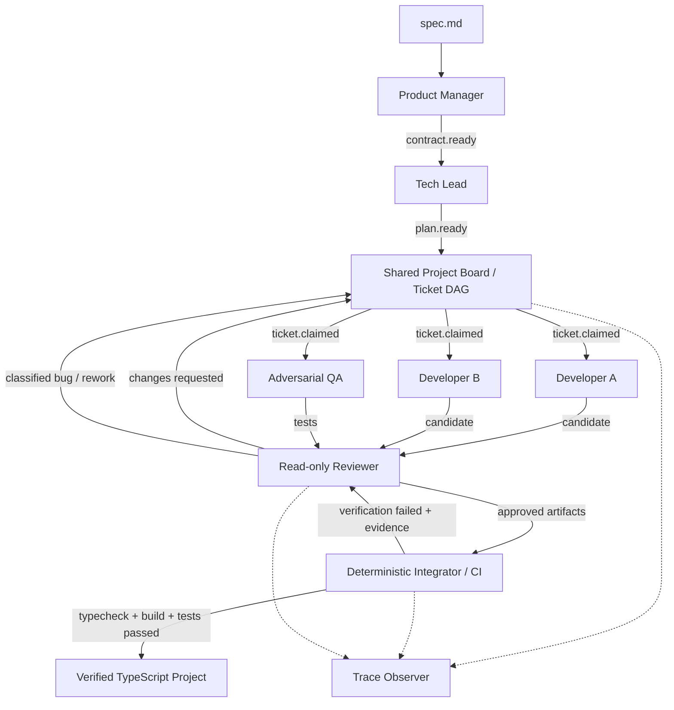

# Architecture and implementation

## Participants

| Participant | Objective and context | Tools and authority | Trigger / output |
| --- | --- | --- | --- |
| Product Manager | Extract observable requirements from the original spec | No coding, filesystem or shell tools | `spec.received` → strict Product Contract |
| Tech Lead | Choose minimal architecture, exact interfaces, file ownership and ticket DAG | No coding or execution tools | `contract.ready` → strict Engineering Plan |
| Developer A | Functional behavior, simple implementation, fast delivery; contract + assigned ticket + interfaces | Read/list/search candidate; write assigned production files; bounded checks | Own `ticket.claimed` → isolated source artifacts |
| Developer B | Validation, boundary cases, error handling and maintainability; reliability ticket and failure evidence | Same bounded tool vocabulary, different owned files and priorities | Own `ticket.claimed` → isolated reliability artifacts |
| QA | Try to break the contract; initially contract + published interfaces, without implementation assumptions | Write only `tests/contract.test.mjs`; cannot edit production | Own `ticket.claimed` → adversarial Node tests |
| Reviewer | Critique artifacts and evidence; classify CI failures and route fixes | Read-only structured inputs, no editing or execution tools | `review.requested` → strict verdict / blocking issues |
| Project Board | Track dependencies, ownership and availability | Deterministic state transitions and scheduling | Plan/rework events → claims for READY work |
| Integrator / CI | Assemble accepted artifacts and determine actual success | Fixed Node/compiler commands, real exit codes | `integration.requested` → verification evidence |
| Trace Observer | Record actual activity and metrics | Deterministic JSONL/log/state writer | Runtime and company events → local trace |

The six AI roles differ in instructions, context, triggers, schemas, evaluation criteria and write authority. All can share a model; role-specific model overrides are optional. PM never receives source tools; QA cannot fix production; the Reviewer cannot fix anything. Coding tools are scoped to the current ticket at turn creation. Each turn uses a fresh `ModelContext` with explicit relevant inputs rather than inheriting every other participant's conversation.

## Mozaik v4 architecture

The pinned dependency is **`@mozaik-ai/core@4.2.0`**. The implementation uses current public `defineRuntime`, `RuntimeState`, `createAgent`, `createHuman`, `SemanticEvent`, `SituationSpecification`, situation processors, and `runLoop` APIs. Mozaik owns orchestration. Baro supplies only the official hosted-authentication helper; the custom JigJoy runner supplies inference. See the official [runtime documentation](https://docs.jigjoy.ai/docs/runtime) and [agent loop](https://docs.jigjoy.ai/docs/agent-loop).



`EngineeringState extends RuntimeState` is the project board: original spec, Product Contract, plan, ticket statuses and retry counts, artifact hashes, review verdicts, command/test results, categorized failures, metrics and explicit human interventions. A snapshot is persisted at milestones and on termination.

The board reacts to events rather than awaiting a fixed sequence of developers. It starts one READY ticket per available owner. Approved dependency artifacts unlock dependent tickets. Development tickets move through `BACKLOG → READY → IN_PROGRESS → IN_REVIEW → TESTING → DONE`, with bounded `FAILED → READY` review repair. `TESTING` means reviewer accepted, waiting for the final global gate; it does not mean tests have passed. Only CI can authorize project completion.

Events include `spec.received`, `contract.ready`, `plan.ready`, `ticket.claimed`, `ticket.completed`, `qa.started`, `qa.completed`, `review.requested`, `review.approved`, `review.changes_requested`, `integration.requested`, `integration.completed`, `verification.started`, `verification.failed`, `verification.passed`, `bug.created`, `rework.requested` and terminal project events.

### Contract and plan self-repair

A schema-valid model response can still violate semantic rules. For example, a plan that makes Developer B depend on Developer A is rejected by the concurrency validator. Instead of immediately ending the run, the factory sends the **same PM or Tech Lead participant** its previous invalid output, the exact redacted validation error, original specification or Product Contract, and explicit non-negotiable invariants. That agent produces a complete corrected response, and the unchanged semantic validator runs again. The factory never fabricates extra tickets or relaxes the independent-developer requirement.

`MAX_PLANNING_RETRIES=2` permits the initial response plus at most two semantic repairs **per planning role**. Zero disables repairs. This budget is separate from provider retries and code/CI repairs. Exhaustion terminates with a clear protocol failure naming the phase, attempt count and last validation error. Basic JSON/schema errors keep their existing protocol-failure path; they are not treated as semantic planning mistakes.

The real events `contract.validation_failed`, `contract.repair_requested`, `plan.validation_failed` and `plan.repair_requested` include the role/run ID, top-level retry index and validation evidence. The initial failed response has retry index 0; requested repairs use 1, 2, etc. Invalid plans/contracts are never published as ready, so dependent participants cannot start from rejected data.

### Real concurrency and isolation

The plan validator requires initially independent work for **both** developers. The board dispatches their claims and QA's claim without awaiting other turns. Mozaik's fire-and-forget `runLoop` and nonblocking situation processors allow their actual inference and tool work to overlap. There is no `await devA(); await devB()` pipeline.

The concurrency test uses a barrier: no worker can finish its initial inference until all three workers have entered it. A sequential implementation would time out. It also checks that the measured work intervals overlap.

```text
.work/<run-id>/<owner>/<ticket-id>/attempt-<retry>/
output/<run-id>/
traces/<run-id>/
  events.jsonl
  activity.log
  state.json
```

Every ticket owns explicit files; overlapping ownership, traversal, symlinks and reserved filenames are rejected. QA has a separate test artifact. Workers submit SHA-256 recorded artifacts rather than overwriting a shared checkout. The integrator combines approved artifacts in deterministic path order and checks hashes before copying and after verification. Repair work is seeded with accepted artifacts and the ticket's previous candidate.

### Deterministic gates and automatic recovery

CI owns the generated `package.json` and `tsconfig.json`; models cannot rewrite verification scripts. Projects use Node built-ins only. CI reuses the installed factory TypeScript toolchain via an ignored `node_modules` directory link, so generated dependency installation is unnecessary during a run. A copied standalone project declares its own development dependencies; run `npm install --ignore-scripts` there before using it.

CI runs, in order:

1. TypeScript typecheck (`--noEmit`).
2. TypeScript build.
3. Node's test runner against QA's `.test.mjs` artifacts.

A failed step stops that attempt. Every process records command, explicit cwd, stdout, stderr, exit code, signal, duration, timeout and spawn error. Text such as “DONE” or “tests passed” is never sufficient evidence.

On implementation/test failure the Reviewer receives the actual command output, contract, ownership and candidate artifacts. It must identify blocking issues and existing owned files. The board creates `BUG-*` tickets, assigns the relevant original owner, wakes that worker, requests another review, integrates the repair and reruns CI. A source ticket's CI repair budget defaults to **2**; review rejection retries are also bounded. Unfixable candidates terminate as `FAILED`.

Provider failures have a separate small retry budget and never create semantic bug tickets. Timeouts, spawn errors and signals are infrastructure failures and terminate with their evidence. Basic structured-output/schema failures and unauthorized tools are protocol failures; semantic planning violations receive the bounded self-repair described above before becoming terminal. Mozaik 4.2.0's fire-and-forget loop does not expose a public rejected-promise callback, so the bounded inference adapter converts provider rejection into a typed fault answer that follows the factory's explicit failure path.

### Provider-compatible inference schemas

`src/runtime/inference-schema.ts` projects full Zod schemas into model-facing generation schemas. A recursive allowlist removes `$schema`, `pattern`, string-length/property-count constraints, uniqueness/contains constraints and unneeded annotations. It visits schema nodes in `properties`, `$defs`, `items`, `prefixItems`, `anyOf`, `oneOf` and schema-valued `additionalProperties`. Literal property names, `required`, `enum` and descriptions remain unchanged. Input schemas are not mutated.

The generic projection preserves useful JSON Schema structure and references. Gemini model names select a narrower legacy profile because Mozaik 4.2.0 sends structured output through `responseSchema`; JSON-Schema-only fields such as `additionalProperties` and `$ref` are omitted there. This distinction follows the [Google generation configuration reference](https://ai.google.dev/api/generate-content#v1beta.GenerationConfig). Current role schemas use objects, arrays, enums and primitives, not references or tuples; future reference/tuple schemas need a corresponding legacy conversion or a JSON-Schema-capable transport. Tools use the generic projection because Mozaik sends their parameters through `parametersJsonSchema`.

This changes only provider guidance. Every returned answer still goes through the original `turn.schema.parse`, `parseContract`/`parsePlan`, and review checks; each tool invocation still runs its original Zod parser. Empty summaries, invalid IDs, excessive string lengths, unexpected keys and semantic DAG/concurrency violations are still rejected locally. Schema projection itself needs no dependency patch; the Gemini tool-loop fix below is separate.

Provider retries apply to the failed inference request inside its existing Mozaik context, preserving completed tool results and Gemini signatures. HTTP 408, 429, 5xx and unknown network failures receive bounded retry; other HTTP 4xx errors stop immediately. `Retry-After` headers and Google RPC `RetryInfo`/retry-delay messages are honored, with exponential backoff when no hint exists. A shared per-model cooldown pauses requests while developer and QA turns remain concurrent. Waiting stops when the Factory terminates. `provider.retry_scheduled` records role, ticket, model, retry, status and delay; final exhaustion does not start another turn-level retry budget.

Worker workspaces are fixed snapshots. If another ticket's planned production files are missing, `run_check` returns explicit deferred verification with `passed: false`; it does not report success or encourage interface stubs. Workers submit their owned files and the Integrator still runs all three mandatory gates on the combined project. When local tests can run, `run_check(test)` builds the complete snapshot first.

Workers can call `finish_work({summary})` to submit artifacts explicitly. The tool verifies that every assigned file exists, then the bounded runner forwards that validated worker summary as the Mozaik terminal answer. This handoff makes no extra provider request and is traced as `worker.submission_completed`, excluded from token/call accounting. It does not approve artifacts or complete the project: independent review, integration and actual CI gates still follow.

HTTP projects have a fourth mandatory deterministic gate: execute `node dist/index.js` with a temporary `PORT` and require an actual HTTP response (any status, with no product-specific route assumptions). The gate rejects silent exits, captures startup errors, and cleans up the process. Supported HTTP applications export an unstarted `createServer()` and start on `PORT` when executed directly. The execution platform is supplied to planning, workers and review so ESM path guards can use portable file URL conversion. This catches startup omissions even when generated QA tests cover only imported servers.

Review retries and CI repairs have separate counters. `reviewRetryCount` bounds review-driven revisions of each ticket; `ciRetryCount` bounds CI-created bugs per original ticket. `retryCount` remains the artifact revision number. A new bug ticket starts its own review counter at zero, so a prior review does not consume the new ticket's repair allowance. Both budgets still use `MAX_RETRIES_PER_TICKET`; neither is unbounded. Reviewers receive an explicit reminder that previous CI evidence was not executed against the new repaired artifacts.

Ordinary review receives `candidateChecks` captured after the latest successful file write and `dependencyArtifacts` for accepted collaborating modules. A later write clears earlier candidate checks. Current failed CI is supplied as `verification` only during triage; ordinary review receives older evidence as `previousVerification`. Passing local checks do not bypass independent review or integrated CI.

Schema-valid but inconsistent Reviewer decisions receive bounded semantic self-repair, using `MAX_PLANNING_RETRIES` for each review decision. The same critic receives the original task, rejected verdict, exact validation error and unchanged ownership/decision invariants. `review.validation_failed` and `review.repair_requested` record this recovery. An ordinary review cannot assign a developer a QA file; correct owned artifacts can proceed to integration, where failing assertions are triaged to their actual owner. Exhaustion is explicit, and invalid verdicts never enter the accepted review history.

### Gemini tool-loop thought signatures

Mozaik 4.2.0's Gemini mapper dropped `Part.thoughtSignature` when producing a `FunctionCallItem`, then reconstructed subsequent function-call history without it. The actual runtime appends the call object directly to `ModelContext`, so a small adapter/context patch fixes the missing metadata without changing orchestration.

`patches/@mozaik-ai+core+4.2.0.patch` adds optional `FunctionCallItem.thoughtSignature`, copies the provider string on response mapping/rehydration and places the same string on the corresponding Gemini `functionCall` part during request replay. The patch covers CommonJS, ESM and both declaration files. There is no global signature cache, no decoding/transformation, no placeholder signature, no disabled thinking and no replacement runtime. See Google's [legacy thinking guidance](https://ai.google.dev/gemini-api/docs/generate-content/thinking) for the provider requirement.

The signature travels with its own call in memory, including across sequential tools and explicit item rehydration. OpenAI and Anthropic mappers ignore this Gemini-only metadata. Normal factory traces do not serialize agent memory; additionally, the observer redacts `thoughtSignature` / `thought_signature` fields recursively in diagnostic events and state snapshots without changing the original context. Optional presence flags can be logged; opaque values must not be logged.

`patch-package@8.0.1` is a pinned runtime installation dependency and `postinstall` reapplies the patch with `--error-on-fail` after every normal install. A fresh `npm ci` replaces the original dependency then applies this checked-in diff automatically. If Mozaik is upgraded, check whether upstream fixed the mapper and update/remove the patch intentionally; do not silently reuse the old-version patch. [Patch maintenance notes](../patches/README.md) describe the exact scope.

### Trace and metrics

`events.jsonl` contains real timestamps, run ID, participant ID, role, ticket ID, action, start/end/instant phase, elapsed time, retry, model, provider token usage when supplied, estimated cost when configured, and human intervention count. Commands have bounded captured output. Raw provider responses/prompts are omitted from local event logs. Environment secrets and common API-key patterns are redacted from persisted evidence. `state.json` includes contract and project state; treat specifications and source as potentially private.

Token totals and cost are `null` when unavailable or incomplete, including offline fixtures. `knownInputTokens` and `knownOutputTokens` preserve measured subsets; metered/unmetered call counters explain coverage. Optional rates are user-supplied estimates, not a pricing claim. Different model prices require choosing suitable rates or extending per-model accounting. Mozaik's optional built-in cloud integration may activate if its credentials already exist; this factory forces its payload redaction to `all`. Local traces are the authoritative evidence.

Normal invocation counts as zero human interventions. `EngineeringState.recordHumanIntervention(reason, description)` is the explicit API for a host/UI to record an actual human action. Hash mismatches fail integrity checks; they do not falsely identify an unknown actor as a human. This v1 does not infer edits made and reverted between checkpoints.


## Configuration

| Variable | Default / purpose |
| --- | --- |
| `FACTORY_PROVIDER` | `.env.example`: `jigjoy`; also `openai`, `anthropic`, `gemini`, legacy `auto` |
| `OPENAI_API_KEY`, `ANTHROPIC_API_KEY`, `GEMINI_API_KEY` | Only for external SDK modes; unnecessary for JigJoy |
| `FACTORY_MODEL` | Hosted setup: `deepseek-flash`; shared fallback for all roles |
| `FACTORY_REASONING_EFFORT` | Hosted setup: `low` (verified); unset delegates to provider defaults. Other values depend on the selected model. |
| `PM_MODEL`, `TECH_LEAD_MODEL` | Optional PM and planning overrides |
| `IMPLEMENTATION_DEV_MODEL`, `RELIABILITY_DEV_MODEL` | Optional developer overrides |
| `QA_MODEL`, `REVIEWER_MODEL` | Optional testing and review overrides |
| `MAX_RETRIES_PER_TICKET` | `2`; bounded review/CI repairs |
| `MAX_PROVIDER_RETRIES` | `1`; additional attempts per failed inference request, preserving its context |
| `MAX_OUTPUT_TOKENS` | Hosted `32768`, external `12000`; reasoning and visible output share this budget |
| `MAX_PLANNING_RETRIES` | `2`; additional semantic repairs for each PM/Tech Lead phase and Reviewer decision (0–5) |
| `MAX_MODEL_CALLS_PER_TURN` | `30`; bounds tool/inference loops |
| `MODEL_TIMEOUT_MS` | Hosted `240000`, external `120000` per inference request |
| `COMMAND_TIMEOUT_MS` | `30000` per child command |
| `RUN_TIMEOUT_MS` | `900000` per factory run |
| `INPUT_USD_PER_MILLION`, `OUTPUT_USD_PER_MILLION` | Unset; optional uniform estimated token rates |

External SDK model names must exist in the pinned Mozaik registry; JigJoy aliases are resolved by the hosted gateway. Custom providers/configurations can be supplied through the `runFactory({ runner })` TypeScript API. Do not put keys in specs, source files or committed `.env` files.
